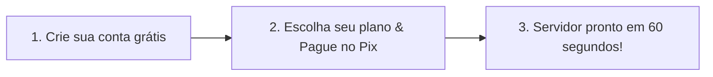

<div align="center">

# 🚀 Zorion Host — Hospedagem Cloud & VPS de Alta Performance no Brasil

### ⚡ Potência máxima, latência ultrabaixa e ativação automática via Pix em menos de 1 minuto.

<p align="center">
  <a href="https://zorionhost.com">
    
  </a>
  <a href="https://painel.zorionhost.com">
    
  </a>
  <a href="https://wa.me/5511930055154?text=Olá,%20gostaria%20de%20tirar%20dúvidas%20sobre%20os%20planos%20da%20Zorion%20Host">
    
  </a>
</p>

---


</div>

---

## 🌟 Por que escolher a Zorion Host?

Se você busca **estabilidade, velocidade e suporte de verdade**, a **Zorion Host** foi feita para você. Esqueça painéis lentos, burocracia para ativar e servidores hospedados fora do país com ping alto. Aqui você tem infraestrutura corporativa na palma da mão.

<div align="center">

| 🇧🇷 Baixa Latência no Brasil | ⚡ Entrega Instantânea (Pix) | 🛡️ Proteção Anti-DDoS |
|:---:|:---:|:---:|
| Servidores em São Paulo com rotas diretas para as maiores operadoras. Ping de **5ms a 20ms** em todo o Brasil. | Pagou no Pix, ativou. Sem esperar aprovação manual. Seu servidor pronto em menos de **60 segundos**. | Mitigação volumétrica inteligente inclusa para manter sua aplicação ou jogo online 24 horas por dia. |

| 💾 Storage NVMe / SSD | 🎛️ Painel Próprio & Intuitivo | 💬 Suporte via WhatsApp |
|:---:|:---:|:---:|
| Discos de alta velocidade com leitura/escrita ultrarrápida. Seus bancos de dados e sistemas voando. | Controle total: ligar, desligar, reiniciar, console web VNC em tempo real e monitor de consumo. | Atendimento rápido e humanizado direto no WhatsApp, sem chamados demorados. |

</div>

---

## 🎯 Feito sob medida para o seu projeto

<div align="center">

```
   🎮 GAMERS & SERVIDORES          🤖 BOTS & AUTOMAÇÕES           🌐 WEBSITES & APIS
 ─────────────────────────       ─────────────────────────      ─────────────────────────
 • FiveM / RedM                  • Bots de WhatsApp             • Node.js, Python, PHP, Java
 • Minecraft (Paper, Forge)      • Disparadores & Chatbots      • Docker & Microserviços
 • Palworld, CS2, Rust           • Bots de Discord / Telegram   • Bancos PostgreSQL & MySQL
 • Painel txAdmin nativo         • Automação de Trade & Scripts • Certificado SSL Grátis
```

</div>

---

## 💼 Conheça Nossos Planos Populares

> 💡 *Precisa de uma configuração personalizada? Montamos na hora com a quantidade exata de vCPU, RAM e Disco que seu projeto necessita!*

| Plano | vCPU | Memória RAM | Armazenamento | Tráfego | Link do Plano |
|:---|:---:|:---:|:---:|:---:|:---:|
| 🥉 **Starter** | 1 vCPU | 2 GB RAM | 20 GB SSD | Ilimitado | [Contratar Agora](https://painel.zorionhost.com) |
| 🥈 **Basic** *(Mais Vendido)* | 2 vCPU | 4 GB RAM | 40 GB SSD | Ilimitado | [Contratar Agora](https://painel.zorionhost.com) |
| 🥇 **Pro** | 3 vCPU | 6 GB RAM | 60 GB NVMe | Ilimitado | [Contratar Agora](https://painel.zorionhost.com) |
| 🚀 **Ultra Gamer** | 4 vCPU | 10 GB RAM | 100 GB NVMe | Ilimitado | [Contratar Agora](https://painel.zorionhost.com) |
| 💎 **Dedicados & Custom** | Até 64 vCPUs | Até 128 GB RAM | Terabytes | 1 Gbps Dedicado | [Falar com Especialista](https://wa.me/5511930055154) |

---

## 🖥️ Um Painel de Controle como você nunca viu

Diga adeus aos painéis antigos e cheios de menus complicados. O painel da **Zorion Host** foi desenvolvido do zero focado na experiência do usuário:

* 📊 **Métricas em Tempo Real**: Monitore o consumo de CPU, Memória RAM e Disco com gráficos fluidos.
* 🖥️ **Console VNC Web & Terminal**: Acesse a tela da sua VPS diretamente do navegador sem precisar instalar programas externos.
* 🌐 **Domínios & SSL Grátis com 1 Clique**: Aponte seu domínio próprio (`seusite.com`) e nosso sistema emite o certificado SSL automaticamente.
* 🔄 **Reinstalação Rápida**: Troque de Sistema Operacional (Ubuntu, Debian, CentOS, AlmaLinux) quando quiser em segundos.
* 📱 **Notificações no Celular**: Receba alertas de fatura, confirmação de pagamento e status da VPS direto no seu WhatsApp.

---

## ⚡ Comece a usar em apenas 3 passos simples



1. **Acesse o Painel**: Entre em [painel.zorionhost.com](https://painel.zorionhost.com) e crie sua conta em 30 segundos.
2. **Escolha o Plano**: Selecione a configuração ideal para o seu projeto e efetue o pagamento no Pix.
3. **Receba o Acesso**: Seu servidor é provisionado instantaneamente e as credenciais são enviadas na sua tela e no seu WhatsApp!

---

## ❓ Perguntas Frequentes (FAQ)

<details>
<summary><b>⏱️ Quanto tempo demora para o servidor ficar pronto após o pagamento?</b></summary>
<p>
A ativação é <b>100% automática e instantânea</b>. Assim que o Pix é identificado pelo nosso sistema (geralmente entre 10 e 30 segundos), o provisionamento é iniciado e em menos de 1 minuto sua VPS já está online pronta para uso.
</p>
</details>

<details>
<summary><b>🛡️ Como funciona a proteção Anti-DDoS?</b></summary>
<p>
Toda a nossa rede conta com proteção Anti-DDoS corporativa integrada na borda. Ataques comuns contra servidores de jogos, APIs e websites são filtrados e mitigados automaticamente sem derrubar o seu serviço.
</p>
</details>

<details>
<summary><b>🐧 Quais sistemas operacionais estão disponíveis?</b></summary>
<p>
Você pode escolher entre as distribuições Linux mais populares do mercado: <b>Ubuntu (22.04 e 24.04 LTS), Debian (11 e 12), CentOS (7 e 8), AlmaLinux e Rocky Linux</b>, além de templates prontos para servidores de jogos.
</p>
</details>

<details>
<summary><b>💳 Quais são as formas de pagamento aceitas?</b></summary>
<p>
Aceitamos <b>Pix</b> (com liberação imediata 24 horas por dia) e <b>Boleto Bancário</b>.
</p>
</details>

<details>
<summary><b>💬 Como funciona o suporte ao cliente?</b></summary>
<p>
Nosso suporte é prestado diretamente via <b>WhatsApp</b> e painel do cliente por técnicos capacitados para resolver dúvidas e auxiliar na gestão da sua infraestrutura.
</p>
</details>

---

## 📞 Canais de Atendimento & Redes

Está com dúvidas ou precisa de uma cotação especial para sua empresa? Fale conosco agora mesmo:

- 🌐 **Site:** [zorionhost.com](https://zorionhost.com)
- 🎛️ **Painel de Clientes:** [painel.zorionhost.com](https://painel.zorionhost.com)
- 💬 **WhatsApp Oficial:** [+55 (11) 93005-5154](https://wa.me/5511930055154)
- ✉️ **E-mail:** [empresa@zorionhost.com](mailto:empresa@zorionhost.com)

---

<div align="center">
  <h3>🚀 Pronto para elevar a velocidade da sua infraestrutura?</h3>
  <a href="https://painel.zorionhost.com">
    
  </a>
  <br/><br/>
  <sub>© 2026 <b>Zorion Host</b>. Infraestrutura de ponta, estabilidade e respeito ao seu projeto. 🇧🇷</sub>
</div>
